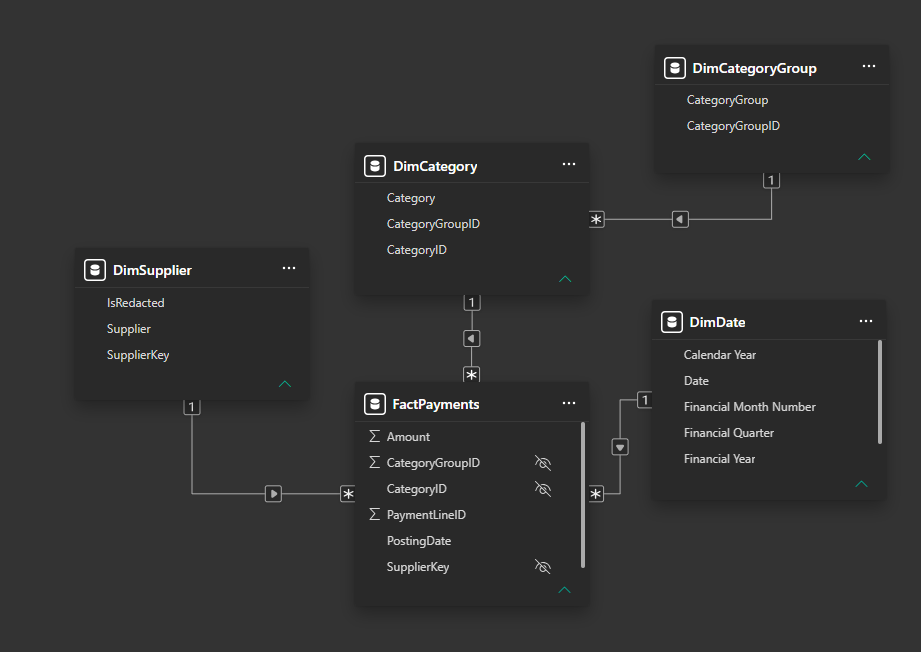
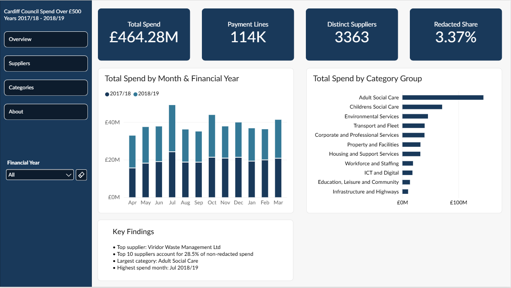
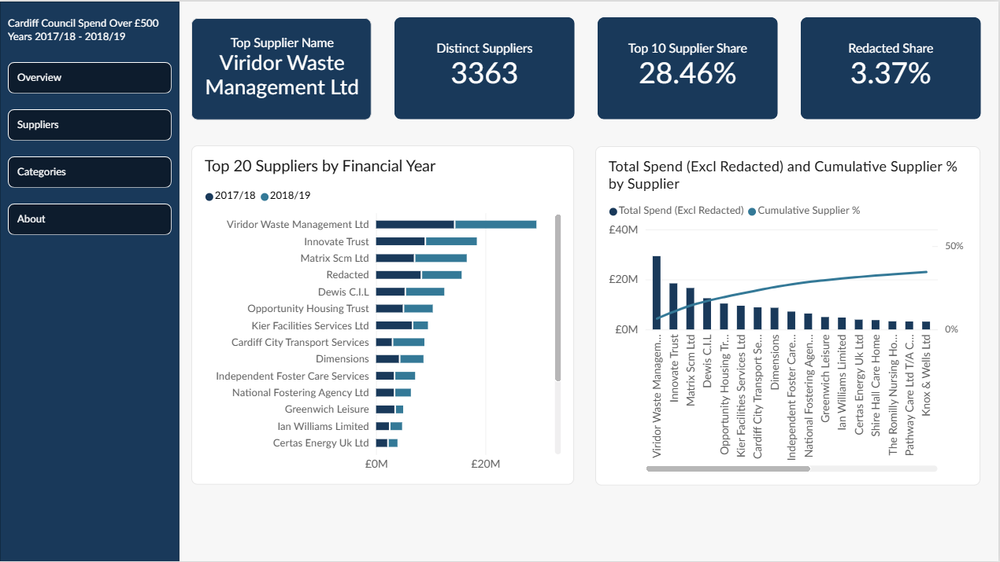
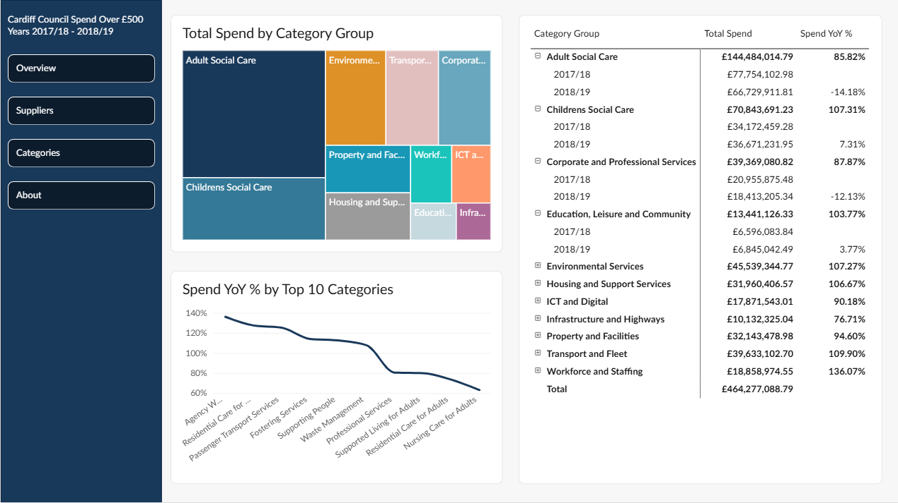
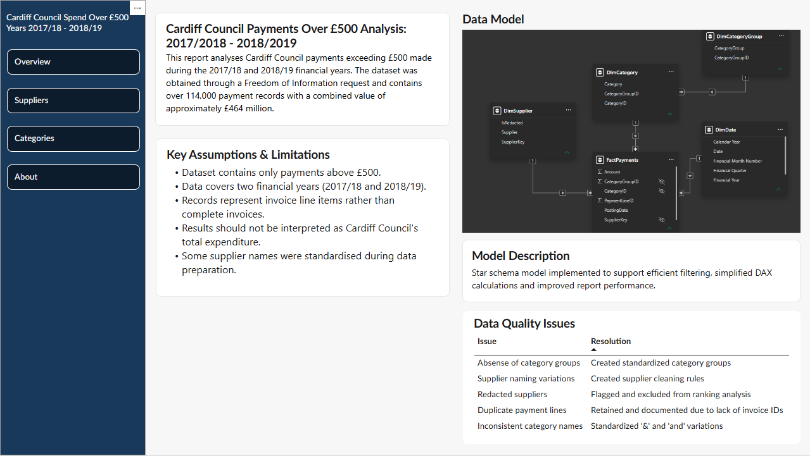

# Cardiff Council Payments Over £500 Analysis (2017-2019)

## Project Overview

This Power BI project analyses Cardiff Council payments exceeding £500 during the 2017/18 and 2018/19 financial years.

The dataset was obtained through a Freedom of Information (FOI) request and contains over 114,000 payment line records representing approximately £464 million of expenditure.

The objective of the project was to:

- Clean and standardise transaction data
- Build a star schema data model
- Develop DAX measures for analysis
- Identify expenditure trends and supplier concentration
- Produce an interactive Power BI report using best practice modelling techniques

---

## Dataset

Source: Cardiff Council FOI Release

Coverage:

- Financial Year 2017/18
- Financial Year 2018/19

Dataset Statistics:

| Metric               | Value   |
| -------------------- | ------- |
| Total Spend Analysed | £464.3M |
| Payment Lines        | 114,278 |
| Distinct Suppliers   | 3,400+  |
| Financial Years      | 2       |

---

## Data Preparation

The raw dataset required several cleansing and standardisation steps before modelling.

### Data Quality Issues Identified

- Inconsistent supplier naming conventions
- Category naming variations
- Redacted supplier records
- Truncated supplier names
- Duplicate payment line records

### Transformation Process

1. Import Excel worksheets
2. Standardise column names
3. Append financial years
4. Clean supplier names
5. Standardise category values
6. Flag redacted suppliers
7. Create surrogate keys
8. Build star schema model

---

## Data Model

The report follows a star schema design.

### Tables

#### FactPayments

Contains individual payment line records.

#### DimDate

Provides calendar and financial year reporting.

#### DimSupplier

Contains supplier information and redaction flags.

#### DimCategory

Contains category and category group information.

### Model Diagram

---

## DAX Measures

Key measures created include:

### Core Metrics

- Total Spend
- Payment Lines
- Distinct Suppliers
- Average Line Value

### Time Intelligence

- Spend Previous Year
- Year-on-Year Change
- Year-on-Year %

### Supplier Analysis

- Top 10 Supplier Share
- Supplier Spend Rank
- Cumulative Supplier Spend
- Cumulative Supplier %

### Category Analysis

- Category Share of Total
- Category YoY %

---

## Dashboard Pages

### Executive Overview

Provides a high-level summary of spending activity.

---

### Supplier Analysis

Examines supplier concentration and spending distribution.

Features:

- Top suppliers by spend
- Pareto analysis
- Supplier concentration metrics

---

### Category Analysis

Explores expenditure by category and category group.

Features:

- Category trends
- Spending distribution
- Year-on-year comparisons

---

### Data Quality & Methodology

Documents cleansing decisions, assumptions and modelling approach.

---

## Key Findings

### 1. Significant Supplier Concentration

A relatively small number of suppliers account for a substantial proportion of council spending.

### 2. July 2018 Recorded the Highest Monthly Spend

The highest monthly expenditure across the dataset occurred during July 2018.

### 3. Social Care Related Spending Represents a Major Cost Area

Adult and children's social care categories account for a significant share of expenditure.

### 4. Data Standardisation Improved Reporting Accuracy

Supplier and category cleansing reduced duplication and improved the reliability of expenditure analysis.

---

## Technical Skills Demonstrated

### Power Query

- Data ingestion
- Data cleansing
- Data transformation
- Data standardisation

### Data Modelling

- Star schema design
- Dimension modelling
- Relationship management

### DAX

- Aggregations
- Time intelligence
- Ranking functions
- Pareto analysis

### Visualisation

- Interactive dashboards
- Drill-down analysis
- Custom tooltips
- Theme design

---

## Tools Used

- Power BI Desktop
- Power Query
- DAX
- Excel
- GitHub

---

## Disclaimer

This analysis is based solely on Cardiff Council payments exceeding £500 as released through a Freedom of Information request. The figures presented should not be interpreted as Cardiff Council's total expenditure.
